<!-- README for github.com/jkjitendra — built with local, GitHub-compatible SVGs -->

  

  <a href="https://jkjitendra.in">Portfolio</a> &nbsp;·&nbsp;
  <a href="https://www.linkedin.com/in/jkjitendra/">LinkedIn</a> &nbsp;·&nbsp;
  <a href="https://github.com/jkjitendra?tab=repositories">Repositories</a>

I'm a **Full Stack Software Engineer** with **6+ years of experience** building real-time, high-throughput systems with **Java, Spring Boot, React, and TypeScript**. I enjoy connecting backend architecture, performance engineering, product experience, and developer tooling.

### 🌌 My engineering universe

<!-- Daily showcase: network on even days since 2026-11-11; terminal on odd days. -->

  

Project network ↔ developer terminal · automatically alternates each day

### 🪐 Featured projects

  

  <a href="https://github.com/jkjitendra/arkil"><b>Arkil</b></a> &nbsp;·&nbsp;
  <a href="https://github.com/jkjitendra/codebundle"><b>CodeBundle</b></a> &nbsp;·&nbsp;
  <a href="https://github.com/jkjitendra/recomart-pipeline"><b>Recomart</b></a> &nbsp;·&nbsp;
  <a href="https://github.com/jkjitendra/transfer-aggregator-service"><b>Transfer Aggregator</b></a> &nbsp;·&nbsp;
  <a href="https://github.com/jkjitendra/EduKitBox"><b>EduKitBox</b></a>

### 🛠️ Tech Stack

<!-- Technology badges grouped by specialty. Items reflect the resume and cited personal-project implementations. -->
My working stack, grouped by area. Each badge includes a technology icon and is kept separate from the rotating project/terminal showcase.

#### Backend & Languages

           

#### Frontend & Desktop

          

#### Databases & Caching

    

#### Messaging & Data Formats

  

#### AWS Cloud

      

#### DevOps & Infrastructure

         

#### Developer Tools & Code Quality

        

#### Security & Identity

  

#### Monitoring & Observability

 

Building useful software. Making complex systems simpler.

