<!-- README for github.com/jkjitendra — built with local, GitHub-compatible SVGs -->

  

  <a href="https://jkjitendra.in">Portfolio</a> &nbsp;·&nbsp;
  <a href="https://www.linkedin.com/in/jkjitendra/">LinkedIn</a> &nbsp;·&nbsp;
  <a href="https://github.com/jkjitendra?tab=repositories">Repositories</a>

I'm a **Full Stack Software Engineer and Team Lead** with **5+ years of experience** building real-time, high-throughput systems with **Java, Spring Boot, React, and TypeScript**. I enjoy connecting backend architecture, performance engineering, product experience, and developer tooling.

### 🌌 My engineering universe

<!-- Daily showcase: network view on 2026-11-11, stack view on 2026-11-12, then repeat. -->

  

Network signals ↔ tech stack · automatically alternates each day

### 🪐 Featured projects

  

  <a href="https://github.com/jkjitendra/arkil"><b>Arkil</b></a> &nbsp;·&nbsp;
  <a href="https://github.com/jkjitendra/codebundle"><b>CodeBundle</b></a> &nbsp;·&nbsp;
  <a href="https://github.com/jkjitendra/recomart-pipeline"><b>Recomart</b></a> &nbsp;·&nbsp;
  <a href="https://github.com/jkjitendra/transfer-aggregator-service"><b>Transfer Aggregator</b></a> &nbsp;·&nbsp;
  <a href="https://github.com/jkjitendra/EduKitBox"><b>EduKitBox</b></a>

### 💻 Who's behind the code?

  

### 🧰 Stack at a glance

| Area | Technologies |
| --- | --- |
| **Backend** | Java, Spring Boot, Spring ecosystem, Go, Node.js, Scala, REST APIs, microservices |
| **Frontend** | React, Next.js, TypeScript, JavaScript, Redux, Tailwind CSS |
| **Data & messaging** | PostgreSQL, MySQL, MongoDB, Cassandra, Redis, Apache Kafka |
| **Cloud & DevOps** | AWS, Docker, Jenkins, CircleCI, Git, Maven, Nomad, Consul |
| **Observability & quality** | Prometheus, Grafana, SonarQube, ESLint, Postman |
| **Security & protocols** | OAuth2/OIDC, JWT, JSON, Protobuf |

### ⚡ Engineering highlights

- ⚙️ Supported **~2.3k RPS** during peak traffic while maintaining **~95ms P95 / ~100ms P99** API latency.
- 🚀 Reduced endpoint latency from **~1 second to ~100ms** through Spring Boot modernization, caching, and database tuning.
- 📈 Built **live polls** and **win-probability** experiences; the latter contributed to **30% higher retention**.
- 🧩 Lead a **4-member engineering team**, driving system design, code reviews, and cross-team delivery.
- 🔍 Designed a **centralized logging framework** with structured logs and request-context propagation.

Building useful software. Making complex systems simpler.

